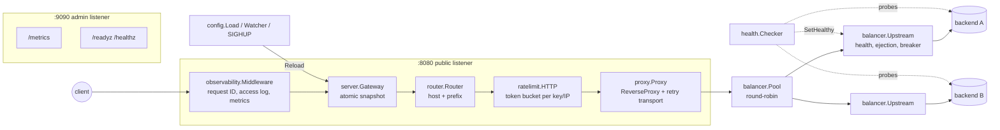

# edge-gateway

A small HTTP API gateway and reverse proxy written in Go. It routes requests by host
and path prefix to per-route upstream pools and keeps them usable when backends
misbehave. It does this with active health checks, passive ejection, per-upstream
circuit breakers, retries limited to idempotent methods, per-client rate limits and
hot config reload. The only dependency outside the standard library is
`gopkg.in/yaml.v3`.

## Features

- **Routing**: exact hosts, wildcard hosts (`*.example.com`) or any host, combined with
  segment-aware path prefixes (`/api` matches `/api/x` but not `/apiary`). Per-route
  `strip_prefix` / `add_prefix` rewrites and timeouts.
- **Load balancing**: round-robin over available upstreams. A retry skips upstreams
  the request already tried.
- **Health**: active HTTP probes with healthy/unhealthy thresholds, plus passive
  ejection after N failed requests in a row.
- **Resilience**: a circuit breaker per upstream (closed, open, half-open with a single
  probe). Retries use exponential backoff with jitter and run only for idempotent
  requests. Each request has a deadline, and each attempt can have its own timeout.
- **Rate limiting**: a token bucket per API key header, falling back to the client IP.
  Rejected requests get `429` with `Retry-After`.
- **Observability**: `X-Request-ID` generation and propagation, JSON access logs via
  `log/slog`, Prometheus metrics on `/metrics`, and `/healthz` and `/readyz` on a
  separate admin listener.
- **Operations**: graceful shutdown on SIGINT/SIGTERM drains in-flight requests. Config
  reloads on SIGHUP or by file polling (`-watch`), swapping the whole config at once
  without dropping requests.

## Architecture



| Package                  | Responsibility                                                         |
|--------------------------|------------------------------------------------------------------------|
| `cmd/edge-gateway`       | Flags, signals, wiring. No logic.                                      |
| `internal/config`        | YAML decoding (unknown keys rejected), defaults, validation, watcher.  |
| `internal/router`        | Immutable, generic host and path-prefix matcher, rewrite rules.        |
| `internal/balancer`      | Upstream state (health, ejection, breaker) and the round-robin pool.   |
| `internal/breaker`       | Consecutive-failure circuit breaker with a half-open probe.            |
| `internal/health`        | Active HTTP probes with hysteresis.                                    |
| `internal/ratelimit`     | Sharded token bucket limiter and its HTTP middleware.                  |
| `internal/proxy`         | Forwarding, retry policy, backoff, error mapping.                      |
| `internal/observability` | Request IDs, slog access log, Prometheus text exposition.              |
| `internal/server`        | Builds snapshots from config, hot reload, admin endpoints, lifecycle.  |

There is no global state. Every component gets its clock, logger, registry and
transport through its constructor. Package boundaries depend on small interfaces:
`proxy.Balancer`, `proxy.Observer` and `health.Target`.

## Design decisions

### Why a breaker per upstream, not per route

Backends usually fail one at a time: one bad deploy, one full disk, one noisy
neighbour. A breaker per route would take the whole pool out of rotation because one
member failed, which turns a partial outage into a full one. With one breaker per
upstream, the balancer skips only the failing member and the rest of the pool absorbs
its traffic.

Each upstream has three separate signals because each one recovers in a different way:

| Signal           | Trips on                         | Recovers via                         |
|------------------|----------------------------------|--------------------------------------|
| Active health    | failed `/health` probes          | successful probes (threshold)        |
| Passive ejection | N failed live requests in a row  | time (`eject_duration`)              |
| Circuit breaker  | N failed live requests in a row  | one successful live probe request    |

In half-open state the breaker lets exactly one request through. Each state change
increments a generation counter, and a result from a request admitted under an older
generation is ignored. Without this, a slow request admitted while the breaker was
still closed could finish later and close a breaker that has since opened.

### Why retries only for idempotent methods

A request that timed out may still have been processed upstream. Retrying a `POST`
could create two orders or charge a card twice. The gateway retries only methods that
RFC 9110 defines as idempotent (`GET`, `HEAD`, `OPTIONS`, `TRACE`, `PUT`, `DELETE`),
and only when the request body can be replayed. A streamed request body cannot be
replayed, so in practice a `PUT` with a body is not retried. Retries happen on
transport errors and on `502`, `503` and `504` responses. Other `5xx` responses go
back to the client as they are. Each retry goes to a different upstream when one is
available.

The backoff is exponential and capped, with "equal jitter": half of the delay is fixed
and half is random. Full jitter can produce delays close to zero, which retry
immediately against an overloaded backend. Equal jitter keeps a minimum gap between
attempts and still spreads out clients that failed at the same moment. All retries
share the route's deadline (`timeout`). `per_try_timeout` stops one slow upstream from
using up the whole deadline.

### Rate limiter design

- **Token bucket with lazy refill.** A bucket stores only `tokens` and `last`. Tokens
  are refilled from the elapsed time when a request arrives, so there are no timers
  and no background goroutine.
- **64 shards.** Each shard has its own mutex and map and is padded to its own cache
  line. A key is assigned to a shard by an inlined FNV-1a hash, which avoids the
  allocations of `hash/fnv`. Unrelated clients rarely contend for the same lock.
- **Lossless eviction.** A bucket that has refilled to full is identical to a new one,
  so it can be deleted without changing behaviour. A shard sweeps such buckets at most
  once per refill period, and only when a new key arrives. Memory therefore grows with
  the number of recently active clients, not with every client ever seen.
- **Separate keyspaces.** API keys and IPs are limited by two different limiters.
  With one shared keyspace, a client could send another client's IP as its API key
  and drain that client's bucket.
- `X-Forwarded-For` is ignored by default because clients can set it to anything.
- The steady-state path makes zero allocations (see the benchmarks below).

### Hot reload strategy

A reload builds a complete new snapshot next to the running one: router, pools,
proxies, limiters and health checkers. It then stores the snapshot in an
`atomic.Pointer`. Requests already in flight finish on the snapshot they started
with, and new requests use the new one. No lock is taken on the request path, and no
request sees a half-applied config. An invalid file is rejected with every
validation error listed, and the running config stays in place.

State carries over where that is safe. Upstreams with the same route, URL and
breaker/ejection settings are reused, which keeps their breaker, ejection and health
state. Limiters with unchanged settings are reused, which keeps their buckets. The
old health checkers stop before the new ones start, so two checkers never drive the
same upstream at once. A change to the listener addresses is rejected with
`ErrRestartRequired`. The HTTP transport is shared across reloads, so keep-alive
connections to upstreams stay open.

`-watch` polls a SHA-256 of the file rather than relying on filesystem notifications.
Polling needs no platform-specific code and still detects editors and Kubernetes
ConfigMaps that replace a file by renaming it.

### Graceful shutdown

On SIGINT or SIGTERM the gateway first marks itself not ready, so `/readyz` returns
`503`. It keeps serving for `drain_delay` so that load balancers can stop sending new
traffic. It then calls `http.Server.Shutdown`, which lets in-flight requests finish
within `shutdown_timeout`. The admin listener shuts down last, so metrics stay
available while traffic drains.

## Running

```sh
make build
./bin/edge-gateway -config configs/example.yaml            # SIGHUP reloads
./bin/edge-gateway -config configs/example.yaml -watch 2s  # also poll the file
./bin/edge-gateway -config configs/example.yaml -validate  # check config and exit
```

With Docker, the compose file starts the gateway in front of two
[`traefik/whoami`](https://github.com/traefik/whoami) upstreams:

```sh
docker compose up --build
```

## Configuration

See [`configs/example.yaml`](configs/example.yaml). Every field except `name` and
`upstreams` has a default. Unknown keys are errors.

```yaml
routes:
  - name: api
    host: ""                 # "", "api.example.com" or "*.example.com"
    path_prefix: /api/
    strip_prefix: true       # /api/users -> /users
    add_prefix: ""           # prepended after stripping
    timeout: 5s              # deadline for the whole request, retries included
    upstreams: [http://127.0.0.1:9001, http://127.0.0.1:9002]
    health_check: {path: /health, interval: 2s, timeout: 500ms, healthy_threshold: 2, unhealthy_threshold: 2}
    passive: {max_failures: 3, eject_duration: 15s}
    breaker: {failure_threshold: 5, open_duration: 10s}
    retry: {attempts: 3, base_backoff: 25ms, max_backoff: 250ms, per_try_timeout: 2s}
    rate_limit: {requests_per_second: 20, burst: 40, key_header: X-API-Key}
```

Validation reports every problem at once:

```text
$ edge-gateway -config broken.yaml -validate
edge-gateway: broken.yaml: routes[0].name: is required
routes[0].upstreams[0]: scheme must be http or https, got "ftp://a"
routes[0].retry.attempts: must be between 1 and 10, got 50
```

## curl examples

```sh
# Round-robin across both upstreams; /api/ is stripped before forwarding.
curl -s localhost:8080/api/hello

# Request ID: propagated if valid, generated otherwise, echoed back to the client.
curl -si -H 'X-Request-ID: demo-123' localhost:8080/api/hello | grep -i request-id
# X-Request-Id: demo-123

# Rate limiting per API key (burst 40, refill 20/s): a fast parallel burst runs dry.
seq 1 100 | xargs -P 20 -I{} curl -s -o /dev/null -w '%{http_code}\n' -H 'X-API-Key: k1' localhost:8080/api/hello | sort | uniq -c
curl -si -H 'X-API-Key: k1' localhost:8080/api/hello | grep -i retry-after
# Retry-After: 1

# No matching route.
curl -s localhost:8080/nope
# {"error":"no route","request_id":"0b811cafab19fd1d9cce9f50d38f3089"}

# Readiness with per-route upstream health (one upstream stopped).
curl -s localhost:9090/readyz
# {"ready":true,"routes":{"api":{"healthy_upstreams":1,"total_upstreams":2}}}

# Metrics.
curl -s localhost:9090/metrics | grep edge_upstream
# edge_upstream_attempts_total{route="api",upstream="127.0.0.1:9002",outcome="error"} 3
# edge_upstream_available{route="api",upstream="127.0.0.1:9002"} 0

# Hot reload.
kill -HUP "$(pgrep edge-gateway)"
```

Metrics exposed:

| Metric                          | Type      | Labels                       |
|---------------------------------|-----------|------------------------------|
| `edge_requests_total`           | counter   | route, method, code          |
| `edge_request_duration_seconds` | histogram | route                        |
| `edge_upstream_attempts_total`  | counter   | route, upstream, outcome     |
| `edge_ratelimited_total`        | counter   | route                        |
| `edge_config_reloads_total`     | counter   | result                       |
| `edge_upstream_available`       | gauge     | route, upstream              |
| `edge_upstream_breaker_state`   | gauge     | route, upstream (0/1/2)      |

## Testing

```sh
make test    # unit and integration tests
make race    # the same with the race detector (needs cgo)
make bench   # router and limiter benchmarks
make lint    # go vet + staticcheck
```

Each package has table-driven unit tests and uses injected clocks, so breaker, limiter
and ejection timing is deterministic. `internal/server` has `httptest` integration
tests that run the full gateway against fake upstreams:

- failover from a dead upstream, and passive ejection that stops traffic to it
- the breaker opening, rejecting without contacting the upstream, then recovering
  through the half-open probe
- retries for `GET` and `DELETE` but never for `POST` or `PATCH`
- `429` with `Retry-After`, per API key and per IP
- active health checks removing and restoring an upstream
- 20 hot reloads under 8 concurrent clients with zero failed requests
- graceful shutdown: `/readyz` turns `503` and the in-flight request still completes
- the route deadline turning into `504`, and admin and metrics output

## Benchmarks

Measured with `go test -bench . -benchmem` on an Intel i5-10300H (4 cores, 8
threads) running Windows 11 and Go 1.27.3. The machine was under heavy unrelated
load at the time, so treat the numbers as upper bounds.

```text
BenchmarkMatch/exact-host-8          18038683     91.09 ns/op    0 B/op   0 allocs/op
BenchmarkMatch/wildcard-host-8       11748073    110.3  ns/op    0 B/op   0 allocs/op
BenchmarkMatch/path-prefix-8          5316002    214.7  ns/op    0 B/op   0 allocs/op

BenchmarkLimiterAllow/keys=1-8        9092733    134.1  ns/op    0 B/op   0 allocs/op
BenchmarkLimiterAllow/keys=1024-8    16640042     77.57 ns/op    0 B/op   0 allocs/op
BenchmarkLimiterAllow/keys=65536-8   14283794    134.7  ns/op    0 B/op   0 allocs/op
```

The router benchmark uses 101 routes: 50 exact hosts, 50 path prefixes and one
wildcard. The limiter benchmark runs in parallel on all 8 threads. With one key
every goroutine contends for the same shard. With 1024 keys the load spreads across
shards and throughput nearly doubles. With 65536 keys the buckets no longer fit in
cache, which costs about as much as the contention did.

## Limitations and next steps

- Retries buffer nothing, so a request with a body is never retried. Buffering small
  bodies up to a size limit would make `PUT` retryable.
- The gateway listens on plain HTTP. TLS termination is expected in front of it, or
  can be added with `http.Server.ServeTLS`.
- Rate limits are enforced per instance. A shared limit across replicas would need a
  shared store such as Redis.
- Trusted proxy CIDRs for `X-Forwarded-For` are not implemented.

## License

MIT, see [LICENSE](LICENSE).
